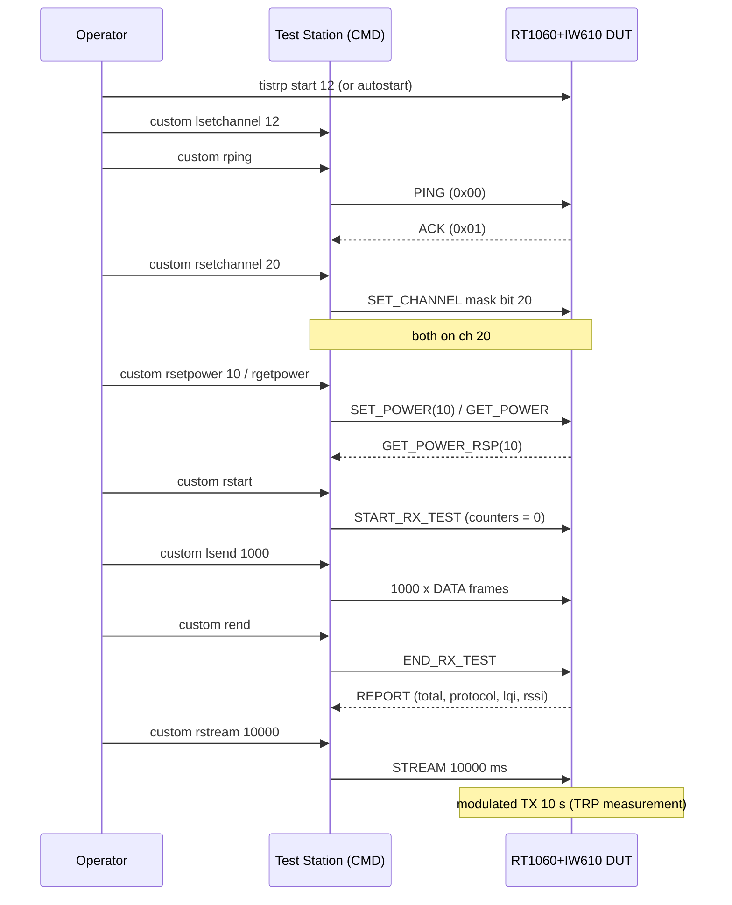

# TIS/TRP OTA DUT for RT1060 + IW610

This example implements the **DUT role** of the Zigbee RF Performance Test Plan (19-01701, Annex B, OTA CMD/DUT
protocol) on an RT1060-EVKC + IW610 (SPI) running the OpenThread CLI. The DUT is driven over the air by a TIS/TRP
command module (CMD), called the Test Station in this document. The CMD commands and behaviour described below were
validated with the reference Test Station firmware; another Annex B command module may differ.

Nothing changes in OpenThread core or in the IW610 RCP firmware: the DUT is built on the host with the public OpenThread
raw-link API and the existing NXP MFG vendor spinel command.

## 1. Compilation flavours

### 1.1 Build switches

| CMake option                 | Default | Effect                                                                                                                                                       |
| ---------------------------- | ------- | ------------------------------------------------------------------------------------------------------------------------------------------------------------ |
| `OT_APP_CLI_FREERTOS_TISTRP` | OFF     | Adds `examples/tistrp/`, compiles `tistrp.c` and defines `OT_APP_CLI_TISTRP_ADDON`, which enables the `tistrp` CLI command and `otAppTistrpInit()`           |
| `OT_LINK_RAW`                | OFF     | **Required.** The DUT uses the OpenThread raw-link API. Without it the build stops on `#error "tistrp addon requires OPENTHREAD_CONFIG_LINK_RAW_ENABLE ..."` |
| `OT_APP_TISTRP_AUTOSTART`    | OFF     | Enters DUT mode at boot on the default channel, so no PC is needed in the chamber. Set to ON by the `iw610_spi_tistrp` flavour                               |

Optional compile-time defines in `tistrp.c`, all `#ifndef`-overridable:

| Define                                    | Default | Meaning                                                                                                                          |
| ----------------------------------------- | ------- | -------------------------------------------------------------------------------------------------------------------------------- |
| `TISTRP_DEFAULT_CHANNEL`                  | 12      | Channel used at boot and by `tistrp start` with no argument                                                                      |
| `TISTRP_DEFAULT_TX_POWER`                 | 10 dBm  | TX power applied at each `tistrp start`                                                                                          |
| `TISTRP_HW_VERSION` / `TISTRP_SW_VERSION` | 0x01    | Values returned to GET_HW_VER / GET_SW_VER                                                                                       |
| `TISTRP_REPORT_BIG_ENDIAN`                | 0       | REPORT counter byte order. 0 = little endian, as expected by the reference Test Station firmware (the spec text says big endian) |

### 1.2 Build commands

> **Which flavour to use**
>
> - **For chamber TIS/TRP measurements, always use `iw610_spi_tistrp` with its default settings (autostart ON).** In the
>   chamber the DUT has no PC attached. With this build it enters DUT mode on its own at every power-up (channel 12, 10
>   dBm), so the CMD can drive it over the air straight away.
> - The other flavours are for development and debugging only:
>   - _TIS/TRP, manual start_ (autostart OFF): bench debugging with a PC on the DUT serial port. DUT mode is entered
>     with `tistrp start`. If this build is powered up alone in the chamber it stays idle and does not answer the CMD.
>   - _Standard_ `iw610_spi`: normal OT CLI image with no TIS/TRP code.
>   - _TIS/TRP on another flavour_: only if the TIS/TRP addon is needed on top of another build configuration.

| Flavour                                  | Command                                                                                                           | `tistrp` CLI | DUT mode at boot          |
| ---------------------------------------- | ----------------------------------------------------------------------------------------------------------------- | ------------ | ------------------------- |
| **Chamber – TIS/TRP, autostart**         | **`./script/build_rt1060 iw610_spi_tistrp`**                                                                      | yes          | yes                       |
| Standard (no TIS/TRP)                    | `./script/build_rt1060 iw610_spi`                                                                                 | no           | no                        |
| TIS/TRP, manual start (bench debug only) | `./script/build_rt1060 iw610_spi_tistrp -DOT_APP_TISTRP_AUTOSTART=OFF`                                            | yes          | no (needs `tistrp start`) |
| TIS/TRP on another flavour               | `./script/build_rt1060 <flavour> -DOT_APP_CLI_FREERTOS_TISTRP=ON -DOT_LINK_RAW=ON [-DOT_APP_TISTRP_AUTOSTART=ON]` | yes          | only with autostart ON    |

`iw610_spi_tistrp` combines `OT_OPTIONS_TISTRP`
(`-DOT_APP_CLI_FREERTOS_TISTRP=ON -DOT_LINK_RAW=ON -DOT_APP_TISTRP_AUTOSTART=ON`) with the standard
`OT_OPTIONS_TRANSCEIVER_IW610_SPI` (EVKC board `evkcmimxrt1060`). It is also built by `./script/build_rt1060 all`.

Output: `build_rt1060/iw610_spi_tistrp/bin/ot-cli-rt1060.elf`

> **Note:** for the `iw610_spi_tistrp` flavour the user arguments are passed after `OT_OPTIONS_TISTRP`, so they
> override it. Both TIS/TRP variants build into `build_rt1060/iw610_spi_tistrp`; check the value in use with
> `grep OT_APP_TISTRP_AUTOSTART build_rt1060/iw610_spi_tistrp/CMakeCache.txt`.

## 2. CLI

The command is added to the ot-cli addon table (`examples/utils/cli_addons/addons_cli.c`).

```
> tistrp
tistrp start [channel] | stop | status | reboot
Done
```

| Command                  | Description                                                                                                                                          | Errors                                                                                                                                        |
| ------------------------ | ---------------------------------------------------------------------------------------------------------------------------------------------------- | --------------------------------------------------------------------------------------------------------------------------------------------- |
| `tistrp start [channel]` | Enters DUT mode: raw link on, RCP PHY re-enabled, promiscuous RX, TX power set to 10 dBm, counters reset, tune to `channel` (default 12) and receive | `Error 7: InvalidArgs` if channel is not a number in [11..26]. `Error 13: InvalidState` if the Thread interface is up (`ifconfig down` first) |
| `tistrp stop`            | Leaves DUT mode: stops any stream, promiscuous off, radio sleep, raw link off. Normal Thread operation is possible again                             | –                                                                                                                                             |
| `tistrp status`          | Shows state and counters                                                                                                                             | –                                                                                                                                             |
| `tistrp reboot`          | Resets the host 50 ms later. Same code path as the OTA REBOOT command. This also restarts the IW610 RCP                                              | –                                                                                                                                             |

Example:

```
> tistrp status
active: 1  channel: 12  power: 10 dBm  stream: 0
total: 106  protocol: 2  lqi: 15032  rssiMag: 22799
Done
```

| Field      | Meaning                                                                                                                              |
| ---------- | ------------------------------------------------------------------------------------------------------------------------------------ |
| `active`   | 1 = DUT mode on                                                                                                                      |
| `channel`  | Current 802.15.4 channel                                                                                                             |
| `power`    | Current TX power (dBm), as read from the radio                                                                                       |
| `stream`   | 1 = modulated continuous TX (STREAM) running                                                                                         |
| `total`    | Every frame received (any content)                                                                                                   |
| `protocol` | Frames starting with `DE DE` (TIS/TRP protocol frames)                                                                               |
| `lqi`      | Sum of LQI (0..255)                                                                                                                  |
| `rssiMag`  | Sum of RSSI as a raw `uint8` (two's complement of the dBm value, e.g. −60 dBm → 196). **Average RSSI (dBm) = rssiMag / total − 256** |

With autostart, the board is in DUT mode right after power-up (`active: 1`, channel 12). Before using Thread, run
`tistrp stop`.

## 3. Sample usage sequence with the Test Station

### 3.1 Setup

| Board                               | Firmware                            |
| ----------------------------------- | ----------------------------------- |
| **CMD** – Test Station              | Any 19-01701 Annex B command module |
| **DUT** – RT1060-EVKC + IW610 (SPI) | `iw610_spi_tistrp` build            |

DUT power-up: with autostart, the DUT is already listening on channel 12 at 10 dBm. Without autostart, run
`ifconfig down` (if needed), then `tistrp start 12`.

### 3.2 Sequence



### 3.3 Commands and expected output

| #   | Step                     | Where | Command                                                                                                      | Expected output                                                                                                                                                 |
| --- | ------------------------ | ----- | ------------------------------------------------------------------------------------------------------------ | --------------------------------------------------------------------------------------------------------------------------------------------------------------- |
| 1   | DUT in DUT mode          | DUT   | `tistrp start 12` → `tistrp status`                                                                          | `active: 1 channel: 12 power: 10 dBm stream: 0`                                                                                                                 |
| 2   | CMD on same channel      | CMD   | `custom lsetchannel 12`                                                                                      | `Channel set to 12`                                                                                                                                             |
| 3   | Link check               | CMD   | `custom rping`                                                                                               | `Received ACK` (`NO ACK` if no answer)                                                                                                                          |
| 4   | Move both to ch X        | CMD   | `custom setchannel 20` (moves DUT then CMD, then PINGs) or `custom rsetchannel 20` + `custom lsetchannel 20` | `Channel set to 20` … `Received ACK`                                                                                                                            |
| 5   | Find the DUT             | CMD   | `custom find 11`                                                                                             | `Set Channel to 11 … NO ACK … Set Channel to N` → `Moving to Channel 11`                                                                                        |
| 6   | TX power                 | CMD   | `custom rsetpower 10` → `custom rgetpower`                                                                   | `Remote Power :10`                                                                                                                                              |
| 7   | Versions                 | CMD   | `custom rhardwareversion` / `custom rsoftwareversion`                                                        | `Remote Hardware Version :1` / `Remote Software Version :1`                                                                                                     |
| 8   | **TIS** (RX sensitivity) | CMD   | `custom rstart` → `custom lsend 1000` → `custom rend`                                                        | `Sending 1000 Packets` / `Complete`, then `Report from DUT module` with `totalPackets : 1001`, `Protocol Packets : 1`, `totalLQI : …`, `totalRSSIMagnitude : …` |
| 9   | **TRP** (radiated power) | CMD   | `custom rsetpower 10` → `custom rstream 10000`                                                               | The DUT sends a modulated carrier for 10 s; measure in the chamber. The DUT answers `rping` again afterwards                                                    |
| 10  | Remote reboot            | CMD   | `custom reboot`                                                                                              | DUT resets (see note)                                                                                                                                           |
| 11  | Leave DUT mode           | DUT   | `tistrp stop`                                                                                                | `Done`. Thread can be used again (`ifconfig up`)                                                                                                                |

Example of a report (100 frames sent on channel 12):

```
custom rend
Report from DUT module
totalPackets : 103          <- 100 + END frame + 2 foreign frames
Protocol Packets : 1        <- END_RX_TEST frame
totalLQI : 14870            -> avg LQI  = 14870/103  = 144
totalRSSIMagnitude : 22254  -> avg RSSI = 22254/103 - 256 = -40 dBm
```

To compute the PER: `PER = 1 − (totalPackets − protocolPackets − foreign) / N_sent`. Use a clean channel (e.g. 25) so
there are no foreign frames.

### 3.4 Notes and known limitations

- **Thread interface:** `tistrp start` needs the Thread interface down (`Error 13: InvalidState` otherwise).
- **No CCA / retry on the CMD:** frames from the reference Test Station firmware are sent without CCA or retry. On a
  busy channel a single SET/GET can be lost; repeat it or use a clean channel.
- **`custom reboot` from the reference Test Station firmware:** this firmware resets itself right after queueing REBOOT,
  so the frame is never sent over the air. Use `tistrp reboot` on the DUT CLI to check the path. After a reboot, allow
  about 8 s before using the DUT, because the IW610 RCP restarts too.
- **During STREAM:** the DUT neither counts nor answers. Wait for the duration to end before sending the next command.
- **RT1060 re-flash:** while the app is running, J-Link cannot reliably reprogram QSPI. Use the serial-downloader boot
  (SW4 `0001`), flash, then switch back to SW4 `0010` and replug USB. Check the reset vector at `0x60002004` or run the
  CLI `version` command.

## 4. Implementation

### 4.1 Files

| File                                     | Content                                                                                            |
| ---------------------------------------- | -------------------------------------------------------------------------------------------------- |
| `examples/tistrp/tistrp.c` / `.h`        | DUT state machine, OTA command handling, CLI                                                       |
| `examples/tistrp/CMakeLists.txt`         | Adds the source to `ot-cli-addons` (PRIVATE), `OT_APP_CLI_TISTRP_ADDON`, `OT_APP_TISTRP_AUTOSTART` |
| `examples/CMakeLists.txt`                | `add_subdirectory(tistrp)` if `OT_APP_CLI_FREERTOS_TISTRP`                                         |
| `examples/utils/cli_addons/addons_cli.c` | Registers the `tistrp` command and calls `otAppTistrpInit()`                                       |
| `script/build_rt1060`                    | `iw610_spi_tistrp` flavour                                                                         |

### 4.2 OTA frame format

```
PSDU = [0xDE][0xDE][0x00][cmdId][payload ...] + FCS(2)
```

No MAC header. The DUT accepts any frame whose first two bytes are `DE DE`; byte 2 is not checked.

### 4.3 OTA commands implemented

| ID     | Command (CMD → DUT)                                 | Payload                      | DUT action                                                                                                             | Response (DUT → CMD)                                                                                              |
| ------ | --------------------------------------------------- | ---------------------------- | ---------------------------------------------------------------------------------------------------------------------- | ----------------------------------------------------------------------------------------------------------------- |
| `0x00` | PING                                                | –                            | –                                                                                                                      | `0x01` ACK                                                                                                        |
| `0x02` | SET_CHANNEL                                         | 4 B big-endian channel mask  | Channel = highest bit set (page ignored). Applied only if in 11..26                                                    | none (CMD then PINGs on the new channel)                                                                          |
| `0x05` | SET_POWER                                           | 1 B, `int8` dBm              | `otPlatRadioSetTransmitPower()`                                                                                        | none                                                                                                              |
| `0x06` | GET_POWER                                           | –                            | Reads the TX power                                                                                                     | `0x07` GET_POWER_RSP, 1 B `int8` dBm                                                                              |
| `0x09` | STREAM                                              | 2 B big-endian duration (ms) | Modulated continuous TX (PRBS9) for the duration. 0 = ignored. RX counting and responses are suspended while streaming | none                                                                                                              |
| `0x0A` | START_RX_TEST                                       | –                            | Resets all counters                                                                                                    | none                                                                                                              |
| `0x0B` | END_RX_TEST                                         | –                            | Builds the report. **Counters are kept;** only START_RX_TEST resets them                                               | `0x0C` REPORT, 16 B = 4 × `uint32` **little endian**: totalPackets, protocolPackets, totalLqi, totalRssiMagnitude |
| `0x0D` | REBOOT                                              | –                            | `otInstanceReset()` after 50 ms                                                                                        | none                                                                                                              |
| `0x11` | GET_HW_VER                                          | –                            | –                                                                                                                      | `0x12` GET_HW_VER_RSP, 1 B (default 0x01)                                                                         |
| `0x13` | GET_SW_VER                                          | –                            | –                                                                                                                      | `0x14` GET_SW_VER_RSP, 1 B (default 0x01)                                                                         |
| other  | `0x01`, `0x07`, `0x0C`, `0x12`, `0x14`, unknown IDs | –                            | Ignored (CMD-bound or unknown); still counted                                                                          | –                                                                                                                 |

Behaviour validated against the reference Test Station firmware:

- Every received frame is counted, even outside a START/END window.
- The END_RX_TEST frame itself is counted, so `totalPackets` = N sent + 1 (+ any foreign frames on the channel). The
  START frame is not counted because START clears the counters.
- RSSI is accumulated as a raw `uint8`, and the TX power is reset to 10 dBm at every start.
- REPORT is little endian. The spec text says big endian; build with `-DTISTRP_REPORT_BIG_ENDIAN=1` if needed.

Not supported: the CMD-only commands of the reference Test Station firmware (`lsend` source and its `0xFF` DATA frame,
which is not an Annex B command, `find`, …). The RT1060 implements the DUT role only.
